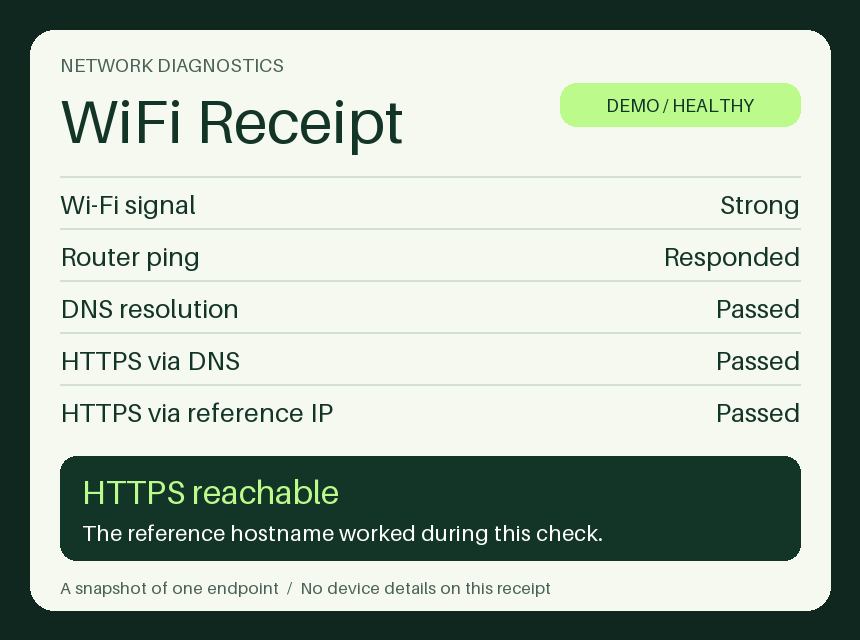

# WiFi Receipt

**Find out where your internet broke. Get a receipt.**

WiFi Receipt runs five network checks and turns the results into a PNG you can share with IT support, your ISP, or a friend. The receipt leaves out your Wi-Fi name, device name, and local IP addresses.



## Quick start

Use Python 3.10 or newer. Live checks run on Windows. Offline demos run anywhere Python and Pillow are available.

```powershell
python -m pip install -r requirements.txt
python wifi_receipt.py check
python wifi_receipt.py demo dns --output dns-demo.png
```

The default output is `wifi-receipt.png` in your current directory. Use `--output` to save a different file.

## Try the offline demos

| Command | Scenario |
| --- | --- |
| `python wifi_receipt.py demo healthy` | Router, DNS, and HTTPS respond |
| `python wifi_receipt.py demo dns` | DNS fails while direct HTTPS works |
| `python wifi_receipt.py demo router` | Router ping and reference endpoint fail |
| `python wifi_receipt.py demo weak-signal` | Wi-Fi signal is weak while HTTPS works |

## What the checks cover

- **Wi-Fi signal** comes from Windows WLAN output. Some translated Windows installations return **Unavailable**.
- **Router ping** checks the IPv4 gateway of a single adapter whose name starts with **Wi-Fi**. A renamed adapter, Ethernet, or an IPv6-only connection can leave this check unavailable. Some routers ignore pings.
- **DNS and HTTPS** check Cloudflare's `one.one.one.one` endpoint. Direct HTTPS uses `1.1.1.1` and still validates the certificate against the hostname. Networks that block this endpoint or require a proxy may produce an inconclusive result.
- The receipt reflects one check at one point in time. **Inconclusive** means the results could fit several causes.

